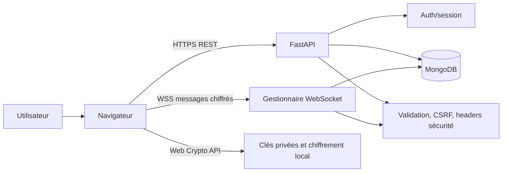
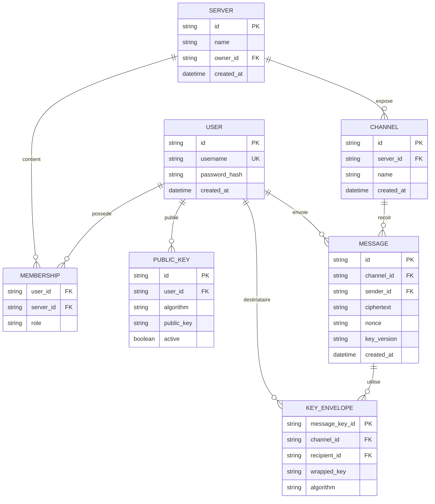
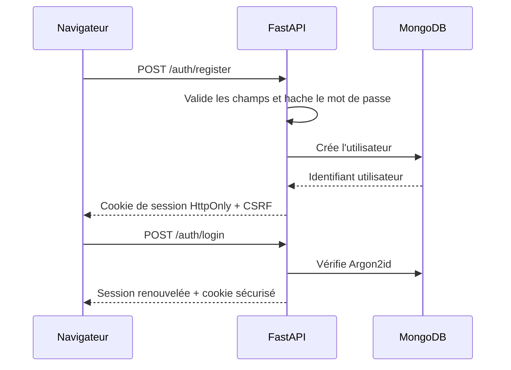
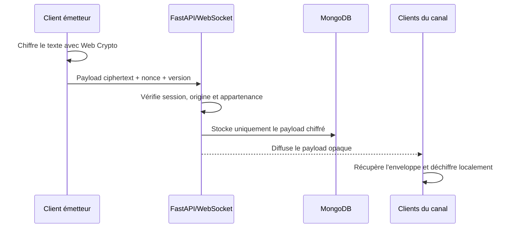

# Plan de réalisation — talk

## 1. Objectif et périmètre

Construire une webapp de messagerie inspirée de Discord et Telegram WebApp :

- inscription, connexion et session sécurisée ;
- serveurs, salons et membres ;
- messages texte transmis en temps réel ;
- chiffrement de bout en bout réalisé dans le navigateur ;
- aucune donnée de message en clair dans l'API, les logs ou MongoDB ;
- environnement reproductible avec Docker Compose ;
- tests unitaires, intégration, sécurité et non-régression exécutés par GitHub Actions.

Le périmètre initial est volontairement limité aux messages texte. Les pièces jointes, appels audio/vidéo, recherche dans le contenu et récupération de clé seront hors périmètre tant qu'un protocole dédié n'aura pas été spécifié.

## 2. Choix techniques

| Besoin | Choix prévu | Raisons |
| --- | --- | --- |
| API | FastAPI | Validation typée, WebSocket natif, documentation automatique |
| Données persistantes | MongoDB | Documents adaptés aux serveurs, canaux, membres et enveloppes de clés |
| Temps réel | WebSocket | Réception immédiate des messages chiffrés |
| Interface | HTML, CSS et JavaScript vanilla | Conforme au sujet, sans chaîne de build inutile |
| Chiffrement | Web Crypto API | Clés générées et utilisées côté client |
| Authentification | Session opaque en cookie HttpOnly | La session n'est pas exposée au JavaScript |
| Mot de passe | Argon2id | Hachage résistant aux attaques hors ligne |
| Déploiement | Docker Compose | Démarrage local identique à la CI |
| Qualité | pytest, Ruff, Bandit et tests navigateur ciblés | Couverture fonctionnelle et sécurité |

MongoDB est le stockage principal de la première version. Le WebSocket sera mono-instance au départ ; une évolution multi-instance pourra ajouter Redis Pub/Sub sans modifier le protocole client.

## 3. Architecture cible

### Responsabilités

- **Navigateur** : génère les clés, chiffre/déchiffre, conserve la clé privée dans IndexedDB et n'affiche que du texte créé localement.
- **FastAPI** : authentifie, autorise, valide les enveloppes chiffrées, diffuse des payloads opaques et ne déchiffre jamais.
- **MongoDB** : conserve les comptes, appartenances, clés publiques, métadonnées de canal et ciphertexts.
- **WebSocket** : vérifie la session et l'appartenance au canal avant de relayer un message.

## 4. Modèle de données prévisionnel

Les index prioritaires seront `username`, `server_id`, `(channel_id, created_at)` et les couples d'appartenance. Les identifiants et noms seront validés avant toute requête afin d'éviter les opérateurs MongoDB injectés.

## 5. Protocole de chiffrement

1. À la première connexion, le navigateur génère une paire de clés d'identité et conserve la clé privée dans IndexedDB.
2. Seule la clé publique est envoyée au serveur, avec un identifiant de version.
3. Pour chaque canal, le client autorisé génère une clé symétrique de canal.
4. Cette clé est emballée séparément pour chaque membre à l'aide de sa clé publique et les enveloppes chiffrées sont stockées par le serveur.
5. Chaque message est chiffré avec AES-GCM et un nonce aléatoire ; le serveur reçoit le ciphertext, le nonce et les métadonnées nécessaires au routage.
6. Le destinataire récupère son enveloppe, déverrouille la clé dans le navigateur puis déchiffre le message.
7. Lorsqu'un membre quitte un canal, une rotation de clé est planifiée avant les prochains messages ; les anciens messages restent lisibles uniquement par les clients ayant déjà possédé l'ancienne clé.

Le serveur ne recevra jamais de clé privée, de clé de canal en clair ou de plaintext. Les logs devront exclure les payloads et les en-têtes d'authentification.

## 6. Flux principaux

### Authentification

### Envoi d'un message

## 7. Découpage de réalisation

### Phase 0 — préparation

- créer l'arborescence attendue (`app`, `frontend`, `tests`) ;
- définir la configuration par variables d'environnement ;
- ajouter Dockerfile, Compose et pipeline CI ;
- documenter les commandes de démarrage et les limites cryptographiques.

### Phase 1 — fondations backend

- créer l'application FastAPI et le healthcheck ;
- connecter MongoDB avec gestion des erreurs ;
- définir les modèles, index et validations ;
- ajouter la configuration CORS stricte et les headers de sécurité.

### Phase 2 — identité et contrôle d'accès

- inscription et connexion ;
- hachage Argon2id ;
- sessions opaques, rotation et expiration ;
- CSRF sur chaque mutation HTTP ;
- autorisation serveur/canal/membre ;
- endpoints de clés publiques.

### Phase 3 — serveurs et canaux

- création et consultation d'un serveur ;
- invitation ou ajout de membres ;
- création et sélection de canaux ;
- refus systématique des accès hors appartenance.

### Phase 4 — chiffrement et messagerie

- module client Web Crypto ;
- IndexedDB pour la clé privée ;
- enveloppes de clés ;
- endpoints et WebSocket de messages chiffrés ;
- gestion des reconnexions, doublons et ordre d'affichage.

### Phase 5 — interface web

- écran connexion/inscription ;
- navigation serveur/canal ;
- liste de messages et formulaire d'envoi ;
- états de chargement, erreur, session expirée et WebSocket déconnecté ;
- rendu avec `textContent` et aucune insertion HTML issue d'un utilisateur.

### Phase 6 — validation et livraison

- exécuter les tests localement dans Docker ;
- exécuter l'analyse statique et les contrôles de sécurité ;
- tester le parcours navigateur ;
- vérifier qu'aucun plaintext n'apparaît dans MongoDB, les réponses ou les logs ;
- mettre à jour le README avec architecture, sécurité, lancement et limites ;
- vérifier la CI sur une branche de travail avant toute livraison.

## 8. Stratégie de tests avant livraison

### Tests unitaires

- validation des noms, longueurs et identifiants ;
- hachage et vérification des mots de passe ;
- création, expiration et renouvellement de session ;
- vérification CSRF et autorisations ;
- chiffrement/déchiffrement côté client avec clés valides et invalides ;
- rejet des payloads trop grands, mal formés ou non chiffrés.

### Tests d'intégration

- inscription puis connexion ;
- mutation sans CSRF refusée ;
- utilisateur extérieur à un serveur refusé ;
- serveur et canal persistés dans MongoDB ;
- message stocké sans texte en clair ;
- diffusion WebSocket uniquement aux membres du canal ;
- expiration de session et reconnexion ;
- redémarrage des conteneurs sans perte de données attendue.

### Tests sécurité et navigateur

- payloads XSS rendus comme texte ;
- opérateurs MongoDB dans les champs rejetés ;
- cookies `HttpOnly`, `Secure` en production et `SameSite` configuré ;
- headers CSP, HSTS en production, `X-Content-Type-Options` et `Referrer-Policy` ;
- vérification de l'absence de plaintext dans les réponses, logs et collections ;
- parcours inscription, connexion, création de canal, échange entre deux utilisateurs et déconnexion.

### Critères de sortie

- `docker compose up` démarre sans intervention manuelle ;
- `docker compose run --rm test` est vert ;
- le linter et les contrôles sécurité sont verts ;
- le parcours navigateur principal est reproductible ;
- aucun secret ou message en clair n'est committé ;
- la documentation décrit les choix et les limites connues.

## 9. Risques et décisions à confirmer pendant l'implémentation

| Risque | Réponse prévue |
| --- | --- |
| Perte de la clé privée du navigateur | afficher clairement qu'aucune récupération de message n'est garantie dans la V1 |
| Rotation de clé après départ d'un membre | implémenter la nouvelle version de clé avant de traiter les nouveaux messages |
| Diffusion WebSocket multi-instance | rester mono-instance pour la V1, documenter l'ajout futur de Redis Pub/Sub |
| Fuite par logs ou erreurs | middleware de journalisation sans corps de requête ni ciphertext décodé |
| Compatibilité navigateur Web Crypto/IndexedDB | vérifier Chrome, Firefox et Edge dans la CI ou la validation manuelle |
| Contradiction Redis ou MongoDB du sujet | retenir MongoDB comme choix principal et justifier ce choix dans le README |

## 10. Ordre de validation proposé

Après chaque phase :

1. lancer le test ciblé de la phase ;
2. lancer le linter et le type-check applicables ;
3. lancer les tests d'intégration dans Docker ;
4. vérifier le diff et l'absence de secrets ;
5. seulement ensuite passer à la phase suivante.

Aucun code applicatif ne sera écrit avant validation de ce plan et de ses choix avec le demandeur.
